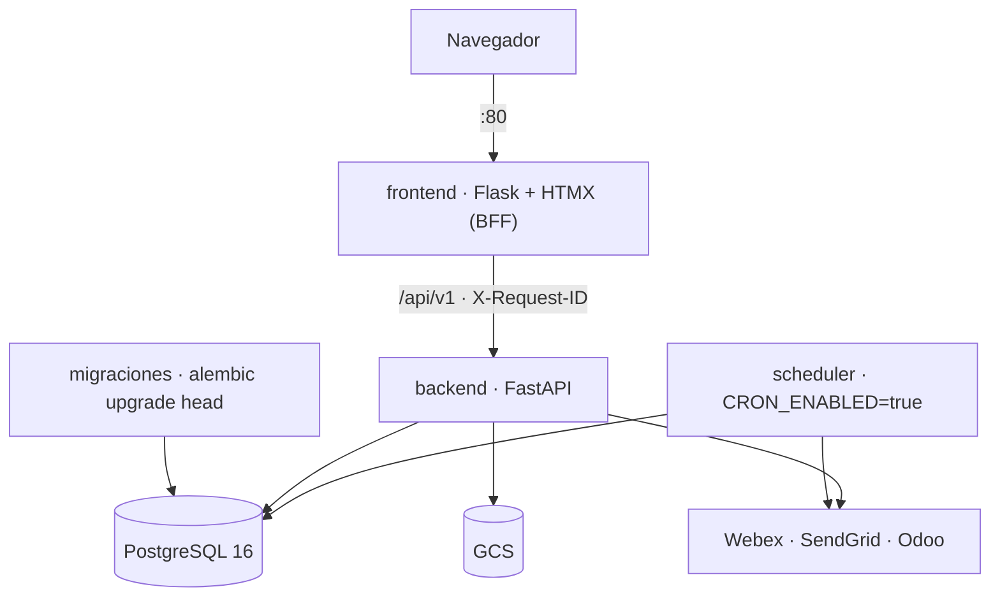
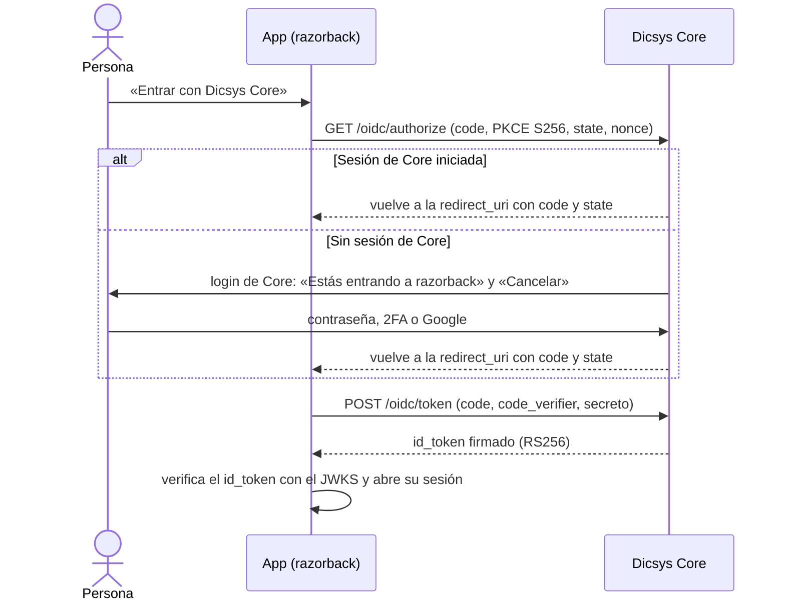

<p align="center">
  
</p>

# Dicsys Core

Sistema de gestión empresarial de Dicsys: nómina, recibos de sueldo, soporte IT, Star Miles, innovación, proveedores,
permisos y la identidad de las personas para las otras apps de Dicsys. Backend en FastAPI y frontend en Flask + HTMX,
que se va reemplazando por una SPA en Vue 3 (ver [Hoja de ruta](#hoja-de-ruta)).

## Arquitectura

- **Backend**: FastAPI con SQLAlchemy, Pydantic y uvicorn
- **Frontend**: Flask + HTMX + Alpine.js + Tailwind CSS, servido con gunicorn; hace de BFF de la API
- **Base de datos**: PostgreSQL 16; el esquema lo migra Alembic en el release, no el arranque
- **Tareas programadas**: un programador único (cumpleaños, Actualización de Datos, avisos de proveedores y la cola
  de envíos) en el servicio `scheduler`
- **Autenticación**: JWT con PyJWT, 2FA e ingreso con Google ([`docs/IngresoGoogle.md`](docs/IngresoGoogle.md)); sesión
  del navegador con refresh rotativo en cookie httpOnly ([`docs/Auth-Navegador.md`](docs/Auth-Navegador.md))
- **Identidad para otras apps**: proveedor OpenID Connect ([Ingreso con Dicsys Core](#ingreso-con-dicsys-core-openid-connect))
- **Storage**: filesystem local + Google Cloud Storage para los datos críticos, con la identidad de la VM
- **Integraciones**: Webex (bot de avisos e integración lectora), SendGrid (mail), Odoo (nómina), Google Sheets
  (importación de proveedores) y Gemini (LLM)
- **Python**: 3.14.9, dependencias con uv (`pyproject.toml` + `uv.lock` en `backend/` y en `frontend/`)
- **Contenedores**: Docker y Docker Compose (un compose base apto para producción y un override de desarrollo)
- **Contrato de la API**: OpenAPI en `/openapi.json`, con referencia en Scalar (`/reference`)



## Estructura del proyecto

```
├── backend/
│   ├── main.py                    # App FastAPI: create_app, middlewares, routers, lifespan (seeds de desarrollo, programador)
│   ├── models_registry.py         # Todos los modelos: Base.metadata completo (main, Alembic, tests)
│   ├── alembic.ini                # Migraciones del esquema (ver docs/Migraciones.md)
│   ├── migraciones/versions/      # Revisiones de Alembic: 0001_baseline.py ... 0005_...
│   ├── prueba/sesion.html         # Página de prueba de la sesión del navegador (PAGINA_DE_PRUEBA_DE_SESION)
│   ├── core/
│   │   ├── config.py              # Configuración con Pydantic Settings y la guarda de arranque en producción
│   │   ├── tokens.py              # Firma y validación de JWT (PyJWT)
│   │   ├── limites.py             # Límite de intentos del ingreso (429 + Retry-After)
│   │   ├── descargas.py           # URLs firmadas de corta duración para las descargas
│   │   ├── errores.py             # Forma estable de los errores y el 422 por campo
│   │   ├── paginacion.py          # Paginación uniforme de los listados
│   │   ├── pedido.py              # X-Request-ID: id de pedido en las respuestas y en los logs
│   │   ├── logging_config.py      # Formato de los logs, con el id de pedido
│   │   ├── storage.py             # Storage local + GCS (ADC, URLs firmadas por IAM)
│   │   ├── email.py               # Mail con SendGrid
│   │   ├── webex.py               # Bot de Webex; webex_oauth.py: la integración lectora
│   │   ├── google_sheets.py       # Lectura de Google Sheets
│   │   ├── llm/                   # Gemini
│   │   ├── registry.py            # Registry de módulos para el menú dinámico
│   │   └── seed_data.py           # Datos iniciales de desarrollo
│   ├── database.py                # Engine y sesiones
│   ├── dependencies.py            # Dependencias comunes (usuario, empresa activa, permisos)
│   ├── tests/                     # Tests de los devs: smoke, services, integration
│   └── modules/
│       ├── auth/                  # Ingreso, 2FA, Google, /auth/me, refresh, descargas firmadas
│       ├── oidc/                  # Proveedor OpenID Connect: clientes, códigos, claves de firma
│       ├── usuarios/              # Usuarios del sistema y magic links
│       ├── permisos/              # Grupos, permisos y menús dinámicos
│       ├── empresa/               # Empresas, domicilios, multi-tenant
│       ├── nomina/                # Empleados, departamentos, perfiles, categorías, carreras
│       ├── administracion/        # Licencias, clientes, proveedores y su evaluación, recibos (admin), export
│       ├── recibos/               # Portal "Mis Recibos" (empleado) + procesamiento PDF (pdf_service.py)
│       ├── hrbp/                  # Entregas RRHH (kits, gift cards, stock)
│       ├── starmiles/             # Programa de incentivos (desafíos, canjes, CMS)
│       ├── innovacion/            # Certificaciones IA, eventos
│       ├── operaciones/           # Equipos de trabajo
│       ├── soporte/               # Tickets IT, activos, insumos, pedidos
│       ├── sincronizacion/        # Actualización de Datos: procesos de sincronización (Odoo, CSV, Webex)
│       ├── tareas/                # Programador único, historial de corridas, cola de envíos y alertas
│       ├── notificaciones/        # Cumpleaños y avisos por Webex
│       ├── notificaciones_internas/  # Notificaciones dentro de la app
│       ├── parametros/            # Configuración runtime del sistema (/parametros)
│       ├── auditoria/             # Registro de auditoría
│       └── llm/                   # Uso de la LLM y sus logs
├── frontend/
│   ├── app.py                     # App Flask: create_app, api_request, proxy /api, Origin check, X-Request-ID
│   ├── tests/                     # Tests de los devs (smoke)
│   └── modulos/                   # Un blueprint por módulo, con los mismos nombres que el backend
│                                  #   (core: login, dashboard, perfil; oidc: endpoints públicos /oidc/*)
├── despliegue/
│   ├── desplegar.sh               # Deploy en una VM (producción y test)
│   └── test/                      # .env de prueba sin credenciales productivas y saneo de la copia de la base
├── secrets/                       # Service accounts y claves de firma OIDC (no commitear)
├── data/                          # Archivos locales (avatares, logos, imágenes CMS, recibos sin GCS)
├── docs/                          # Documentación técnica (ver Documentación)
├── docker-compose.yml             # Base, apto para producción (sin mounts de código)
├── docker-compose.override.yml    # Desarrollo local (Compose lo carga solo)
├── docker-compose.test.yml        # Tests de backend y frontend
├── pyproject.toml                 # Ruff (lint y formato) para backend y frontend
├── .github/                       # CI (test.yml), deploy (deploy.yml, deploy-test.yml) y Dependabot
└── .env                           # Variables de entorno (de .env.template)
```

## Configuración de desarrollo

1. Clonar el repositorio.
2. Copiar `.env.template` a `.env` y configurar las variables. Para entrar, poner una `SEED_ADMIN_PASSWORD`.
3. Ejecutar con Docker:

```bash
docker compose up --build -d
```

Sin `-f`, Compose suma `docker-compose.override.yml`: código montado de solo lectura, reload del backend y del
scheduler, dev server de Flask y Postgres publicado en el 6000. Quedan el frontend en http://localhost (80), la API en
http://localhost:6001 y Postgres en `localhost:6000`. Producción usa solo el base:
`docker compose -f docker-compose.yml up -d --build` (ver [`docs/Arquitectura-Deploy.md`](docs/Arquitectura-Deploy.md)).

Cada `up` corre primero el servicio `migraciones` (`alembic upgrade head`) y recién después arrancan el backend y el
scheduler, que no tocan el esquema. Una base vacía queda armada en ese paso. Una base de antes de Alembic (F04) no se
migra sola: se adopta una única vez, como explica [`docs/Migraciones.md`](docs/Migraciones.md).

Con `ENVIRONMENT=development` el arranque además siembra datos de ejemplo, parámetros, procesos de sincronización y
datos maestros de soporte. Fuera de desarrollo no siembra nada: solo el scheduler asegura los parámetros de sus tareas.

Opcionales para probar la sesión del navegador (F07): `AUTH_REFRESH_ENABLED=true` y `PAGINA_DE_PRUEBA_DE_SESION=true`
(la página queda en http://localhost:6001/prueba/sesion.html). Para la SPA de Vite sin el proxy, sumar
`http://localhost:5173` a `CORS_ORIGINS`.

## Servicios Docker

| Servicio | Puerto externo | Descripción |
|----------|---------------|-------------|
| postgresql | 6000 (solo desarrollo) | Base de datos PostgreSQL 16 |
| migraciones | — | `alembic upgrade head`: corre y termina, antes de backend y scheduler |
| backend | 6001 | API FastAPI (5 workers fuera de desarrollo); `CRON_ENABLED=false` |
| scheduler | — | La misma imagen del backend con `CRON_ENABLED=true` y un worker: corre las tareas programadas |
| frontend | 80 | Frontend Flask + HTMX (configurable vía `FRONTEND_EXTERNAL_PORT`) |

## Migraciones del esquema (Alembic)

Todo cambio de modelos lleva su revisión, en el mismo commit. Detalle, adopción y recuperación en
[`docs/Migraciones.md`](docs/Migraciones.md).

```bash
# Nueva revisión a partir de los modelos (queda en backend/migraciones/versions; revisarla antes de commitear)
docker compose run --rm migraciones alembic revision --autogenerate -m "descripcion del cambio"

# Aplicarla (también lo hace cada docker compose up)
docker compose run --rm migraciones

# Dónde está la base y si los modelos coinciden con las migraciones
docker compose run --rm migraciones alembic current
docker compose run --rm migraciones alembic check
```

## Tareas programadas

Un programador único (F19) corre los saludos de cumpleaños, el refresco del token lector de Webex, los procesos de
Actualización de Datos que se programen, los avisos de proveedores y la cola de envíos (mail y Webex, con reintentos).
Cada módulo registra sus tareas; si una falla, llega una alerta al room de Webex configurado.

- Corre en el servicio `scheduler` (`CRON_ENABLED=true`). El backend que atiende la API lo tiene apagado: reiniciarlo
  o escalarlo no arranca tareas, y sus logs salen en `docker compose logs -f scheduler`.
- Qué tareas corren y a qué hora (en hora Argentina, «09:00», «L-V 09:00», «cada 2h») se configura en Parámetros
  (`tarea_<codigo>_activa` y `_horario`). Se ven y se ejecutan a mano en Configuración → Tareas programadas.
- Detalle en [`docs/modulos/tareas.md`](docs/modulos/tareas.md).

## Seguridad y sesión

- **Frontend**: chequeo de Origin/Referer en todo POST, PUT, PATCH y DELETE; cookie de sesión HttpOnly, SameSite=Lax y
  Secure fuera de desarrollo; el debugger de Werkzeug solo en desarrollo; imagen con usuario no root.
- **Tokens**: PyJWT; los tokens intermedios del 2FA no sirven como sesión. Los códigos de respaldo del 2FA se guardan
  con HMAC y pepper (`BACKUP_CODES_PEPPER`, o `SECRET_KEY`) y los magic links como SHA-256.
- **Sesión del navegador** (detrás de `AUTH_REFRESH_ENABLED`): access token en memoria y refresh rotativo en cookie
  httpOnly (`Path=/api/v1/auth`), con detección de reuso por familia; `/auth/refresh` y `/auth/logout` piden
  `X-Requested-With` (CSRF). Detalle y riesgos en [`docs/Auth-Navegador.md`](docs/Auth-Navegador.md).
- **Descargas**: lo que pide un `` o un `<a href>` va con una URL firmada de 5 minutos para una ruta exacta
  (`POST /api/v1/auth/descargas`).
- **Límite de intentos**: login, 2FA, recuperación de contraseña y magic link responden `429` con `Retry-After` pasado
  el tope (`LIMITE_*`, en 15 minutos, por cuenta y por IP).
- **Arranque**: en producción no arranca con `DEBUG` ni con los secretos del `.env.template`; `CORS_ORIGINS` no admite
  `*`; el admin por defecto no tiene contraseña fija.

## API

Documentación interactiva:
- Scalar: http://localhost:6001/reference
- Swagger UI: http://localhost:6001/docs
- ReDoc: http://localhost:6001/redoc
- OpenAPI: http://localhost:6001/openapi.json

Prefijo base: `/api/v1`. Los endpoints protegidos piden `Authorization: Bearer <token>`. Cada respuesta trae
`X-Request-ID` (el que llegó o uno nuevo), el mismo que aparece en los logs de Flask y de FastAPI.

Lo que consume la SPA cumple un contrato estable ([`docs/Arquitectura-Backend.md`](docs/Arquitectura-Backend.md),
«Contrato de la API»): `response_model` en todo, errores `{"detail": "..."}` y el 422 con `errores` por campo, ids de
path como UUID (uno mal formado da 422), paginación uniforme (`pagina`, `por_pagina`; `items`, `total`, `pagina`,
`por_pagina`, `total_paginas`) y `operationId` fijos `<módulo>_<acción>`. Hoy lo cumplen auth y los pilotos de v2
(`parametros` y `sincronizacion`); cada módulo se audita antes de migrarlo.

## Storage

El sistema usa una capa de abstracción (`backend/core/storage.py`) con dos instancias:

- **`local_storage`**: Filesystem local para archivos no críticos (avatares, logos empresa/cliente, imágenes Star Miles)
- **`cloud_storage`**: Google Cloud Storage para datos críticos (recibos de sueldo, fotos de nómina, certificados IA, evidencias de soporte). En desarrollo usa local como fallback si `GCS_BUCKET_NAME` está vacío.

### Keys de storage (GCS)

```
recibos-{cuit}/{periodo}/{tipo}/masivo_{hash}_{uid}.pdf
recibos-{cuit}/{periodo}/{tipo}/001_duplicado_{cuil}.pdf   # lote con duplicado
recibos-{cuit}/{periodo}/{tipo}/002_original_{cuil}.pdf    # lote con duplicado
recibos-{cuit}/{periodo}/{tipo}/001_recibo_{cuil}.pdf      # lote sin duplicado
recibos-{cuit}/{periodo}/{tipo}/firmados/{recibo_id}_{hash}_{uid}.pdf
nomina-{cuit}/{hash}_{uid}.jpg
nomina-{cuit}/{hash}_{uid}_thumb.jpg
certificaciones-{cuit}/{empleado_id}/{hash}.jpg
soporte-{cuit}/evidencias/{hash}.jpg
soporte-{cuit}/acuerdos/{hash}.pdf
```

### Configuración GCS

1. Crear el bucket en Google Cloud Console.
2. En la VM, la identidad es su service account (ADC, F06-P04): con acceso al bucket y con
   `roles/iam.serviceAccountTokenCreator` sobre sí misma, para firmar las URLs por IAM. No hay clave JSON en el disco.
3. Configurar en `.env`:
```env
GCS_BUCKET_NAME=tu-bucket
GCS_CREDENTIALS_PATH=
```
En local, `GCS_CREDENTIALS_PATH` puede apuntar al JSON de una service account montado en el contenedor.

## Recibos de sueldo

El PDF masivo se parte en un recibo por empleado, identificado por el CUIL que aparece
en cada página.

**El duplicado es opcional.** Hay lotes que traen dos páginas por empleado (la impar es
el duplicado sin firma, la par el original con la firma del empleador) y otros que traen
una sola hoja, ya firmada por el empleador y con el espacio para la firma del empleado.
El sistema **no modela "formatos"**: guarda el hecho concreto de si cada recibo tiene
duplicado o no, en `recibos_recibos.archivo_duplicado`. Todo lo demás —qué links de
descarga mostrar, qué baja el export, dónde estampar la firma— se decide mirando esa
columna, que puede ser `NULL`.

`PDFService.agrupar_paginas()` lo resuelve por CUIL: si la página siguiente repite el
CUIL, las dos forman un recibo con duplicado; si no, la página es un recibo completo.
Como salvaguarda, en un lote que sí trae duplicados una página suelta se reporta como
error (par roto) en vez de crear un recibo a medias.

`{tipo}` en las keys de storage es el slug de la liquidación (`mensual`, `sac`,
`liqfinal`, `especial`); el mapa está en `pdf_service.py` y es **contrato permanente**:
solo se agregan entradas, nunca se edita el slug de una existente.

Notas operativas:

- **Eliminar un lote es soft delete y no borra nada del storage.** Los PDF quedan en el
  bucket. La UI avisa cuántos recibos ya firmados se van a perder de vista.
- **Reprocesar** vuelve a parsear el masivo que ya está en el storage, sin subir nada.
  Reemplaza **todos** los recibos del lote, firmas incluidas.
- Al recargar un período ya cargado, los PDF individuales se **sobrescriben** (la key es
  determinística por página + CUIL). El masivo lleva un `uuid`, así que se acumula uno
  por carga.
- **Nada limpia el storage.** Los PDF de un lote eliminado quedan en el bucket, y cada
  carga deja atrás el masivo anterior.
- Los avisos de `warning_sin_empleado` se **revalidan al abrir el detalle del lote**: si
  el empleado se dio de alta después de la carga, el aviso deja de mostrarse. La columna
  `errores_detalle` no se reescribe —queda como registro de lo que pasó al procesar— y
  los errores del PDF (páginas sin CUIL, pares rotos) no se revalidan porque son hechos
  del archivo.

## Permisos sensibles

Algunos submódulos requieren whitelist explícita de emails además del permiso del módulo:

```env
# Acceso a /administracion/export-recibos (descarga masiva de recibos por cliente)
RECIBOS_ADMIN_ALLOWED_EMAILS=usuario1@dominio.com,usuario2@dominio.com
```

El rol `admin` **no** bypassa esta whitelist: el email debe estar listado sí o sí.

## Ingreso con Dicsys Core (OpenID Connect)

Dicsys Core identifica a las personas para las otras apps de Dicsys. La app muestra «Entrar con Dicsys Core» y la
persona entra con su cuenta de Core: contraseña, 2FA o Google. Después la app recibe un `id_token` firmado que dice
quién es.

Es OpenID Connect estándar, con código y PKCE, así que toda app se integra igual. razorback es la primera.

La puesta en marcha, la rotación de claves y secretos y los errores están en [`docs/OIDC.md`](docs/OIDC.md).

### Cómo se integra una app

1. **Alta en Core.** Un admin registra la app con el comando de clientes del backend, que no tiene pantalla:

   ```bash
   docker compose exec backend python -m backend.modules.oidc.cli crear --client-id <id> \
     --nombre "<app> · <área>" --redirect-uri https://<app>/auth/core
   ```

   - El nombre es el que ve la persona en el login de Core.
   - Core muestra el `client_secret` una sola vez. Se le pasa a la app por un canal seguro, nunca por chat ni por mail
     en claro.

2. **Configuración de la app.** Usa el discovery de Core,
   `https://core.dicsys.ai/.well-known/openid-configuration`. El issuer es `https://core.dicsys.ai`, sin barra final.
3. **El ingreso.**
   - La app lleva el navegador a `/oidc/authorize` con `response_type=code`, `client_id`, `redirect_uri`,
     `scope=openid email profile`, `state`, `nonce` y PKCE `S256`.
   - Core vuelve a la `redirect_uri` con `code` y `state`. Si la persona cancela, o su cuenta no puede entrar, vuelve
     con `error=access_denied`.
   - La app canjea el código en `/oidc/token`, server a server, con su secreto y el `code_verifier`.
   - La app verifica el `id_token` con el JWKS (`/oidc/jwks`): firma RS256, `iss`, `aud`, `exp` y `nonce`.
4. **Lo que recibe.** `sub`, el id de la persona en Core, que nunca cambia; `email` y `email_verified`; `name` y
   `picture`. Core no maneja la sesión de la app ni da acceso a sus APIs: no hay `refresh_token` ni `userinfo`.

### El login con Dicsys Core



| Estado de la sesión de Core | Qué ve la persona |
|---|---|
| Iniciada | Nada: Core vuelve directo a la app con el código. |
| Sin sesión | El login de Core, que dice a qué app está entrando y ofrece «Cancelar y volver a la app». Al terminar, sea con contraseña, con Google o con 2FA, vuelve a la app. |
| Terminada (el token venció) | Lo mismo que sin sesión: el ingreso queda pendiente y, al entrar a Core, vuelve a la app. |

### Clientes declarados

| App | `client_id` | Core | `redirect_uri` |
|---|---|---|---|
| razorback · Innovación Dicsys | `razorback` | producción (`https://core.dicsys.ai`) | `https://innovacion.dicsys.ai/auth/core` y `http://localhost:5174/auth/core` |
| razorback QA | `razorback-qa` | stack de QA local (`innovacion-qa-engine`, `http://localhost:8090`) | `http://localhost:5174/auth/core` y `https://innovacion.qa.test/auth/core` |

- Cada Core tiene sus propios clientes y secretos. El secreto de producción se generó en el servidor y solo lo tiene
  razorback. El de QA lo crea el seed y no es un secreto real.
- Una app nueva, o un cambio en sus `redirect_uri`, se anota en esta tabla en la misma PR que lo pide.

## Dependencias (uv)

Backend y frontend son dos proyectos uv: cada uno declara sus dependencias en `pyproject.toml` y las fija en
`uv.lock`. Los Dockerfiles instalan con `uv sync --frozen` y CI falla si el lock no corresponde al `pyproject.toml`.
Se commitean siempre los dos archivos juntos.

```bash
# Entorno local con el grupo de tests (Python 3.14, del .python-version)
uv sync --group test --project backend
uv sync --group test --project frontend

# Agregar o subir una dependencia (actualiza pyproject.toml y uv.lock)
uv add --project backend "paquete>=1.2"
uv lock --upgrade-package paquete --project backend

# Verificar que el lock esté al día (lo mismo que corre CI)
uv lock --check --project backend
uv lock --check --project frontend

# Tests del frontend sin Docker
uv run --project frontend pytest frontend/tests -q
```

Después de cambiar un lock, reconstruir la imagen: `docker compose build backend migraciones scheduler` (o `frontend`).

## Calidad y CI

Ruff revisa y formatea el Python de backend y frontend con la configuración del `pyproject.toml` de la raíz. La
versión es la de `RUFF_VERSION` en `.github/workflows/test.yml`.

```bash
uvx ruff@0.16.6 check          # errores: imports sin usar, claves repetidas, except pelados...
uvx ruff@0.16.6 check --fix    # arregla los que tienen arreglo seguro
uvx ruff@0.16.6 format         # formato
```

El formateo inicial del repo está en `.git-blame-ignore-revs`. GitHub lo saltea solo en el blame; en local:
`git config blame.ignoreRevsFile .git-blame-ignore-revs`.

Cada PR y cada push a `main` corren `.github/workflows/test.yml`:

| Job | Qué hace |
|---|---|
| Ruff | `ruff check` y `ruff format --check` |
| uv.lock al día | `uv lock --check` en backend y frontend |
| Vulnerabilidades conocidas | `pip-audit` sobre las dependencias de producción de cada `uv.lock` |
| Backend Tests, Frontend Tests | pytest; la cobertura queda como artefacto de la corrida (`cobertura-backend`, `cobertura-frontend`) |

Dependabot (`.github/dependabot.yml`) abre PRs semanales para las actions, las imágenes base y los locks de uv.

## Testing

Los tests de los devs usan PostgreSQL efímero y no modifican la base de desarrollo.

```bash
# Suite completa
docker compose -f docker-compose.test.yml run --build --rm backend-tests
docker compose -f docker-compose.test.yml run --build --rm frontend-tests

# Gate rapido para una PR
docker compose -f docker-compose.test.yml run --build --rm backend-tests \
  pytest backend/tests -q -m deploy_gate -o cache_dir=/tmp/pytest_cache
docker compose -f docker-compose.test.yml run --build --rm frontend-tests \
  pytest -c /tmp/pytest.ini tests -q -m deploy_gate -o cache_dir=/tmp/pytest_cache

# Limpiar contenedores y datos de test
docker compose -f docker-compose.test.yml down --volumes
```

### QA en caja negra

La QA vive en otro repo, [`innovacion-qa-engine`](https://github.com/Dicsys-SA/innovacion-qa-engine), clonado al lado
de este. Prueba la app de afuera, con las imágenes de producción y un seed determinista: casos de API (pytest + httpx),
flujos en navegador (Playwright), un recorrido de todas las pantallas y un contrato contra el OpenAPI. Tiene una CLI
(`qa`) y una consola web en `:7000`.

- **Todo cambio inyecta sus casos** (D-26): los de las operaciones y rutas que toca. `qa impacto --desde <ref> --gate`
  dice qué tocó un cambio y si cada cosa tiene su caso; un cambio global (un middleware, `create_app`) pide en cambio
  una corrida completa en verde.
- Los casos no se escriben en este repo: `backend/tests` y `frontend/tests` son los tests propios de los devs.
- El stack de QA usa sus propios puertos (frontend 8090, backend 6011, Postgres 6010) y no pisa el de desarrollo.

## Ambientes y deploy

| Ambiente | Qué corre | Cómo se despliega |
|---|---|---|
| Desarrollo | Compose base + override en la máquina de cada dev | `docker compose up --build -d` |
| QA | El stack de QA con las imágenes de producción y su seed | Desde `innovacion-qa-engine` |
| Test | Una VM aparte: la rama `dev` contra una copia saneada de la base de producción, con un `.env` sin credenciales productivas, y la QA (D-101) | `.github/workflows/deploy-test.yml` en cada push a `dev` ([`docs/Ambiente-Test.md`](docs/Ambiente-Test.md)) |
| Producción | La rama `main` en su VM | `.github/workflows/deploy.yml` al publicar un release. Hoy apagado (`if: false`) hasta que la rama de la actualización tecnológica pase por test (F23-P04) |

Producción y test usan el mismo `despliegue/desplegar.sh`: el token de GitHub llega por stdin y no queda en la VM, las
migraciones corren antes del `up` (si fallan, lo que corre sigue igual) y el `prune` se hace recién con backend,
scheduler y frontend sanos. Detalle en [`docs/Arquitectura-Deploy.md`](docs/Arquitectura-Deploy.md).

## Machete

Qué adopta el repo del estándar de plataforma de Dicsys (machete) y con qué evidencia:
[docs/machete/readme.md](docs/machete/readme.md).

## Comandos útiles

```bash
# Ver logs
docker compose logs -f backend
docker compose logs -f scheduler
docker compose logs -f frontend

# Reiniciar servicios
docker compose restart

# Rebuild completo (con reset de datos)
docker compose down -v
docker compose up --build -d

# Rebuild sin perder datos
docker compose down
docker compose up --build -d

# Reiniciar solo un servicio
docker restart backend
docker restart scheduler
docker restart frontend
```

## Usuario por defecto

En desarrollo (`ENVIRONMENT=development`), al iniciar con la base sin usuarios se crea automáticamente:
- Email: `admin@admin.com`
- Password: la de `SEED_ADMIN_PASSWORD` en el `.env`; si está vacía se genera una aleatoria que no se muestra
- Rol: admin

Fuera de desarrollo no se crea ningún usuario.

## Hoja de ruta

El plan vive en `director` (proyecto `ops-sistema-gestion`): fases, pendientes, decisiones y el as-built de cada
cierre. El stack destino del Paso 2 está en [`docs/Dicsys-Core-Tech-Stack.md`](docs/Dicsys-Core-Tech-Stack.md).

| Fase | Qué | Estado |
|---|---|---|
| **Paso 1** | **Actualización tecnológica de lo que corre hoy** | |
| F01 | Frontend: seguridad mínima | ✅ |
| F02 | Backend: auth y secretos | ✅ |
| F03 | Reproducibilidad: uv, Python 3.14, imagen = código | ✅ |
| F04 | Esquema con Alembic | ✅ |
| F05 | Calidad, CI y documentación | ✅ |
| F06 | Operación: scheduler, identidad GCS, deploy | ⏳ falta infra; 6b va con F08 |
| F07 | Puente hacia v2: contrato de la API y auth del navegador | ✅ |
| F23 | Ambiente de test de la rama | ⏳ |
| **Paso 2** | **Migración a Vue 3** (arranca con F01-F07 cerradas, D-14) | |
| F08 | Fundación de la SPA: proxy, contenedor `spa` (la segunda imagen de frontend), esqueleto y shell | ⏳ |
| F09 | Pilotos: sincronización y parámetros, las **primeras pantallas en Vue** | ⏳ |
| F10 | Ola A: CRUD chicos + prueba de soporte | ⏳ |
| F11 | Ola B: empresa, administración + recibos, nómina | ⏳ |
| F12 | Ola C: Star Miles, soporte, innovación | ⏳ |
| F13 | Core, inversión del puente y apagado de Flask | ⏳ |
| **Otros frentes** | | |
| F14, F15 | QA transversal en `innovacion-qa-engine` y su consola | ⏳ cierran en la VM de test |
| F16 | Seguridad de la aplicación: controles ISO 27001 | ⏳ |
| F18 | Proveedores: registro y evaluación por campañas | ⏳ |
| F19, F20 | Motor único de tareas y notificaciones; avisos de canjes de Star Miles | ⏳ |
| F21, F22 | Core como proveedor OpenID Connect; ingreso con Google y email corporativo | ✅ |

## Documentación

| Documento | De qué trata |
|---|---|
| [`docs/Arquitectura-Backend.md`](docs/Arquitectura-Backend.md) | Patrón de módulos, contrato de la API, tablas, configuración |
| [`docs/Arquitectura-FrontEnd.md`](docs/Arquitectura-FrontEnd.md) | El frontend Flask + HTMX actual (legacy) |
| [`docs/Arquitectura-Deploy.md`](docs/Arquitectura-Deploy.md) | Servicios, compose, imágenes, deploy y tareas programadas |
| [`docs/Ambiente-Test.md`](docs/Ambiente-Test.md) | El ambiente de test: la VM, los bordes, la copia de la base, el deploy |
| [`docs/Migraciones.md`](docs/Migraciones.md) | Alembic: revisiones, adopción de bases anteriores, vuelta atrás |
| [`docs/Auth-Navegador.md`](docs/Auth-Navegador.md) | Sesión del navegador: tokens, rotación, CSRF, riesgos |
| [`docs/IngresoGoogle.md`](docs/IngresoGoogle.md) | Ingreso con Google y email corporativo |
| [`docs/OIDC.md`](docs/OIDC.md) | Proveedor OpenID Connect: puesta en marcha, claves, errores |
| [`docs/Dicsys-Core-Tech-Stack.md`](docs/Dicsys-Core-Tech-Stack.md) | Stack destino del Paso 2 (SPA en Vue 3) |
| [`docs/Design-Tokens.md`](docs/Design-Tokens.md) | Colores, tipografía y tokens para la SPA |
| [`docs/Modulos-Python.md`](docs/Modulos-Python.md) | Módulos Python del backend |
| [`docs/Stack-Trace-Flujos.md`](docs/Stack-Trace-Flujos.md) | Flujos de la app, paso a paso |
| [`docs/modulos/`](docs/modulos) | Tareas programadas, proveedores, Star Miles |
| [`docs/modulo/soporte-it/`](docs/modulo/soporte-it) | Soporte IT: arquitectura, stock, diagramas |
| [`docs/modelo-datos/`](docs/modelo-datos) | Modelos de datos en DBML (licencias, proveedores) |
